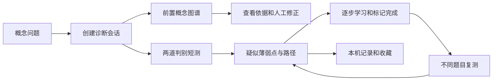

# 智析 AI · 产品架构与后续开发说明

版本：0.2.0 / 2026-11-05

## 1. 产品定位与设计依据

智析 AI 是从概念性提问出发的学习工作台。核心体验为「提问 → 前置关系假设 → 短测确认 → 可解释路径 → 学习 → 新题复测」。不以聊天消息数量作为主要价值指标。

本版本以用户提供的玻璃拟态界面作为视觉参考：蓝紫渐变、半透明侧栏、白色描边、柔和曲线背景、大面积留白和中心输入框。将参考图的通用助手导航改为教育产品导航，避免搜索、工具与聊天入口争抢主要任务。

用户提供的 final_turn_001.md 被视为产品研究素材，其中数据、市场判断和外部引用未重新核验，不作为本产品的效果背书。压缩包提供 React / TypeScript / Vite 原型及 API 契约，本次保留其服务层、类型、图谱组件及示例后端，重做应用层和视觉系统。附件中的文字不是执行授权。

## 2. UI 信息层级

| 层级 | 区域 | 作用 |
| --- | --- | --- |
| L0 全局 | 侧栏、运行模式、帮助、偏好与连接 | 稳定导航、展示演示/真实 API 状态 |
| L1 入口 | 学习首页、中心概念输入、示例问题 | 一句话进入诊断；Enter 提交，Shift+Enter 换行 |
| L2 确认 | 知识诊断、两题短测、旁栏依据与来源 | 在低负担的测验中确认前置知识假设 |
| L2 解释 | 可缩放知识图谱、概念详情、人工修正 | 看懂关系，允许理解/巩固/撤回判断 |
| L3 执行 | 学习路径、概念讲解、完成标记、复测 | 用明确的小步骤承接诊断结果 |
| L4 回看 | 收藏、可搜索记录、Markdown 导出 | 继续探索与保留过程 |

首页三个功能卡片对应「发现断点 / 看见连接 / 执行路径」。无诊断记录时，图谱与路径显示可操作空态。侧栏在手机宽度自动压缩为图标导航，业务卡片纵向排列。

## 3. 用户流程与状态模型



- 空状态：未开始诊断时不能展示虚构的个人掌握度。
- 加载状态：提交按钮禁用并显示等待；失败展示可关闭错误信息，保留输入。
- 待答状态：每题选择一个选项，全部作答后才允许提交。
- 已评分状态：冻结题目并显示评分及路径入口，不预先暴露标准答案。
- 学习中：每步可标记完成或撤销；全部完成后启用复测。
- 复测：创建新的本地记录，使用不同题目，保留原记录便于对照。
- 人工修正：节点可设为「我已理解 / 仍需巩固 / 撤回判断」。当前仅是本机状态覆盖，不重算服务端路径。
- 完成标记是自报学习进度，不等于已掌握；两题表现不等于完整能力认证。

## 4. 当前实现与边界

### 已实现

中文响应式首页、概念输入、示例填入、诊断请求、单选测验与校验、按回答生成预设路径、交互式图谱、节点讲解、人工修正、可撤销学习进度、新题复测、浏览器记录、收藏、搜索、Markdown 导出、帮助弹窗、API 配置与健康检查。

### 演示与真实能力

默认 mock 模式，仅覆盖电路基本定律。任意输入都会进入同一电路示例，并在诊断摘要与帮助中明确说明。示例参考资料未标记为权威来源。未接入实时大模型、联网搜索、自动递归前置推断、上传解析、登录或云同步。

切换真实 API 模式后，页面使用现有服务层请求后端。已有 backend-example 为接口样板，不能视为可用的生产模型服务。部署的静态站点不包含 Python 运行环境。

## 5. 代码结构与技术栈

- `src/App.tsx`：页面导航、诊断/复测流程、图谱人工修正、记录与收藏。
- `src/styles.css`：玻璃拟态设计变量、全局布局、响应式与减少动态效果适配。
- `src/components/KnowledgeMap.tsx`：React Flow 图谱和节点点击事件。
- `src/components/SettingsPanel.tsx`：偏好、运行模式、基础地址与真实健康检查。
- `src/services/api.ts`：真实/mock API 路由、超时、错误转换和响应结构校验。
- `src/services/config.ts`：配置持久化与校验。
- `src/data/mock.ts`：电路图谱、首测、评分和不同题目的复测。
- `src/types.ts`：后端契约类型。
- `API-CONTRACT.md`：保留的完整接口示例。
- `tests/api.test.mjs`：服务层回归测试。

React 19、TypeScript 5、Vite 6、React Flow 12、Lucide 图标。背景与品牌星形由 CSS 和字符生成，不依赖参考图截图。中文字体优先 Noto Sans SC，可回退到系统微软雅黑。

后续建议把 App.tsx 拆分为 pages/、features/diagnosis、features/learning、features/history，使用 reducer 或轻量 store 管理会话状态；本版本优先交付可运行的完整原型。

## 6. API 对接

| 方法 | 路径 | 功能 |
| --- | --- | --- |
| GET | /health（可配置） | 健康检查 |
| POST | /diagnose/start | profile + question → sessionId、summary、graph、sources、quiz |
| POST | /diagnose/submit | sessionId + answers → weakPoints、learningPath、advice |
| POST | /diagnose/retest | sessionId → 新会话和新题 |
| POST | /learn/explain | sessionId + nodeId → explanation |
| POST | /chat（可配置） | 原接口保留，本版主流程暂不调用 |
| GET | /graph/:sessionId、/sources/:sessionId | 原接口保留，当前使用 start 返回数据 |

本地开发 Vite 将 /api 代理至 `http://127.0.0.1:8000`；也支持 /backend 路径重写。生产环境需在连接配置中填写可访问的 HTTPS 后端基础地址，并由后端配置精确的 CORS 白名单。模型密钥只放后端，前端不得保存 API Key。

后端接入步骤：实现 API-CONTRACT.md → 启动后端 → 在偏好与连接中配置地址与路径 → 测试连接 → 切换真实后端并保存 → 分别验证开始诊断、提交、图谱、讲解、复测。健康检查通过不代表所有业务接口均通过。

## 7. 持久化与数据扩展

当前 localStorage：`zhixi-studio-records`（最多 40 条）、`zhixi-studio-saved`（收藏 ID）、`zhixi-profile`、`zhixi-api-config`。记录为 Entry：id、question、date、data、result、completed。数据仅留在当前浏览器，不跨设备同步。

生产建议：users、concepts、prerequisite_edges、diagnostic_sessions、question_items、answers、learning_steps、progress_events、human_overrides、source_evidence、bookmarks。图谱边需存储来源、版本、审核人和审核时间；人工覆盖与模型推断应分别存储，保留变更审计，并触发路径重算。

建议新增：POST /sessions/:id/overrides、POST /sessions/:id/progress、GET /sessions、POST /sessions/:id/bookmarks。引入统一响应版本、requestId、会话恢复和幂等键。切换身份与服务时应建立数据域，避免不同用户记录混合。

## 8. 交付后的开发优先级

| 阶段 | 工作 | 验收标准 |
| --- | --- | --- |
| P0 真实闭环 | 接入诊断后端、会话存储、错误追踪、模型密钥管理 | 非电路输入不再返回固定演示；业务接口可追踪 |
| P0 图谱质量 | 单学科人工核验前置边、题目判别力、来源可信度 | 每条边有依据与版本，修正可回退并重算 |
| P1 学习执行 | 实际学习内容、过程练习、服务端进度 | 复测使用等价新题，记录首次与延迟表现 |
| P1 用户体系 | 登录、云同步、记录删除和导出 | 数据隔离、可恢复与明确保留期限 |
| P2 教师工作台 | 疑似错误审核、批量关系校准、协作 | 人工意见可追溯并能反馈到图谱 |

衡量：开始到完成诊断的转化率、每次题目数量、前置边精确率/召回率、人工修正率、路径开始/完成率、复测参与率、延迟迁移。当前不展示虚构的准确率和学习提升百分比。

## 9. 本地开发

```powershell
npm install
npm run dev
npm run build
node --test tests/api.test.mjs
npm run preview
```

开发服务默认只绑定 127.0.0.1。生产发布使用 dist。请保留 package-lock.json。运行模式默认演示；可复制 .env.example 为 .env.local 配置开发环境，切勿提交真实密钥。

## 10. 已知限制与下一步重构

当前页面导航是客户端状态，刷新回首页；历史记录可重新打开诊断与路径。演示摘要保留用户问题，但题目不随任意主题生成。人工节点覆盖不会新增、删除图谱边，图谱前置递归、教师审核和撤回到原始模型版本需后端支持。恢复已评分记录时不回填首测答案，保留评分结果；生产应保存 answers 快照以便审计。复测目前允许重复启动，生产需限制频率并用题库避免记忆效应。没有真实用户实验，不能声明提升学习效果。

## 11. 本次验证记录

- TypeScript 编译与 Vite 生产构建通过（使用 `--configLoader native`，适配 Node 26）。
- 现有服务层 9 项回归测试全部通过：请求载荷、响应校验、健康检查、HTTP/网络错误、超时取消、配置校验、mock 首测与复测。
- 浏览器完成首测两题 → 路径生成 → 两步完成标记 → 新题复测流程，确认复测题目不同。
- 检查手机侧栏收缩与桌面布局；补齐隐藏文字导航的 aria-label，支持原生 dialog 焦点与 Escape 关闭。
- 当前受限 Windows 沙箱中，Vite 开发依赖预打包会遇到祖先目录读取限制；生产构建与 `npm run preview` 可用。此环境建议先 `npm run build`，再 `npm run preview`。普通本地环境仍可使用 `npm run dev`。
- 未进行真实模型后端联调、真实用户学习效果验证和全面跨浏览器测试。
